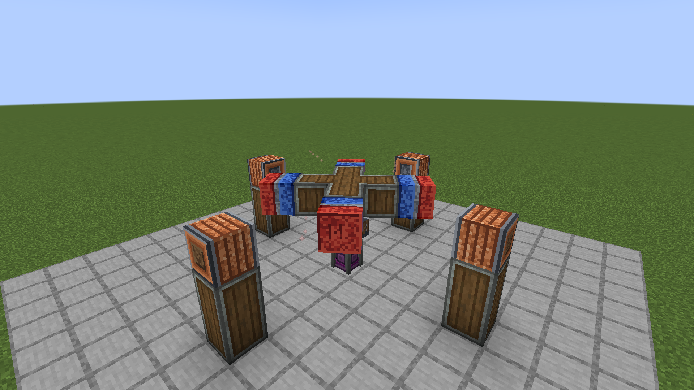
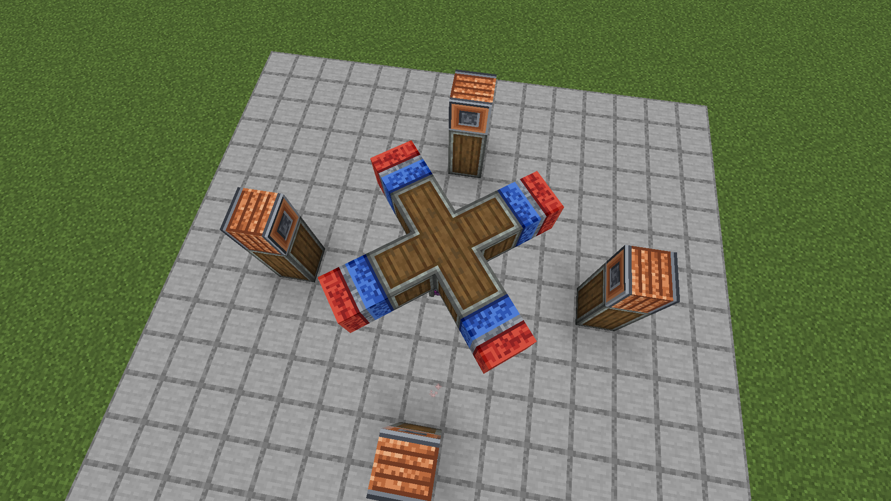

# Create: Induction

Build a real generator. Put magnets on a rotor, spin it with rotational force, and coils standing around it turn the passing magnets into electricity. Nothing is simulated behind a recipe or a multiblock check: the rotor is a [Sable](https://modrinth.com/mod/sable) physics structure, every magnet is a real magnet, and each coil measures the magnetic flux actually sweeping through it.

## How it scales

There is no bigger tier to craft. You get more power by engineering a better machine:

- **Faster** – voltage follows how quickly the flux changes, so power grows with the square of rotor speed.
- **Closer** – a magnet's field falls off steeply. One block of air gap is worth a lot.
- **More magnets, more coils** – every magnet that passes every coil adds to the output.
- **Smarter layout** – alternate poles, face magnets at the coils, mount coils above and below as well as around. Bad layouts cancel themselves out.

Electricity is never free. A coil that delivers power pushes back on the magnets (Lenz's law), the rotor slows, and the bearing has to work harder to keep it turning. The stress the bearing draws from your Create network is the mechanical power it really delivers, so an unloaded rotor is cheap to spin and a hard-working one is not.

## Blocks

**Dynamo Bearing** – Feed it rotation from behind, glue a structure to its face and click it with an empty hand. The structure becomes a physics rotor driven towards the shaft's speed. Its stress impact rises and falls with the load.

**Permanent Magnet** – An always-on magnet. The red face is north. It attracts and repels the Redstone Magnets from Create Aeronautics exactly like they do each other.

**Induction Coil** – Generates from any magnet moving past its face: Permanent Magnets, Redstone Magnets, on a rotor, on an airship, on a pendulum. Works in the world or on a physics structure.
Give it a redstone signal and it runs the other way: it spends energy to become an electromagnet, with strength set by the signal. Pulse coils in time with a rotor and you have a motor.

Engineer's Goggles show voltage, current and power on coils, and rotor speed and delivered power on the bearing.

## Energy

- **Forge Energy** – coils hold a small buffer and push into any neighbouring block that accepts FE. A full buffer means no load, no current and no braking.
- **[Power Grid](https://modrinth.com/mod/power-grid)** (optional) – every coil gets a positive and a negative terminal on its back. Wire it up and it is a real voltage source in the circuit: the current your circuit draws is the current that brakes the rotor, and voltage applied from outside drives the coil as an electromagnet.

## Requirements

- [Create](https://modrinth.com/mod/create) 6.0.10+
- [Sable](https://modrinth.com/mod/sable) 2.0.6+
- [Create Aeronautics](https://modrinth.com/mod/create-aeronautics) (provides Simulated and its magnets)
- NeoForge, Minecraft 1.21.1. Needed on both client and server.

## Configuration

Everything that affects balance is in the server config `create_induction-server.toml`: magnet strength, coil gain and resistance, Forge Energy per watt, stress per watt and the bearing's torque and power limits.

## Notes

- Blocks on a rotor must be held together with Super Glue, as with any Create contraption.
- This is an early release. Balance values are a first pass and may change.
