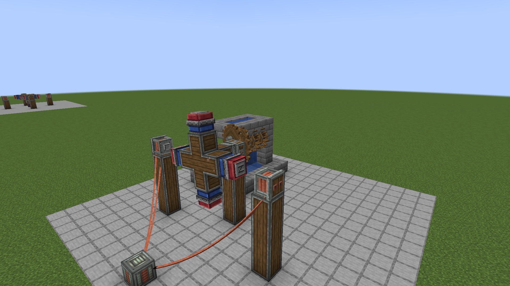
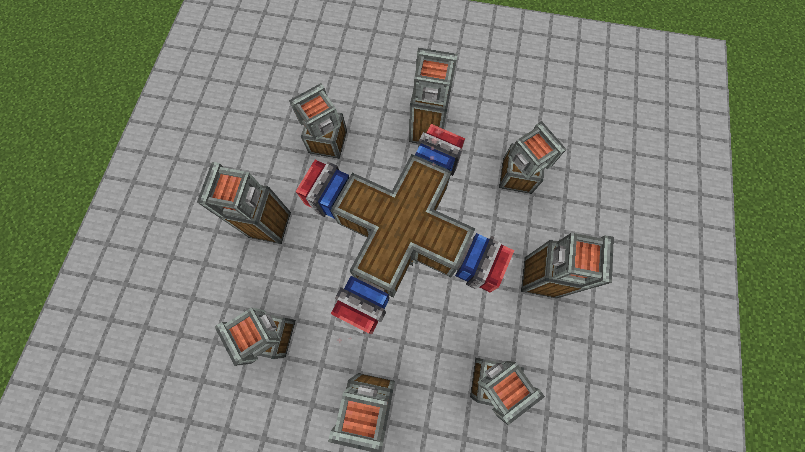
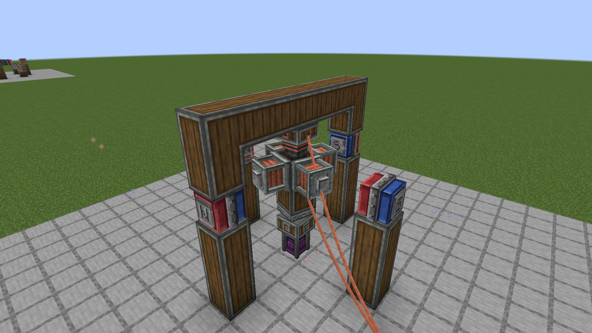
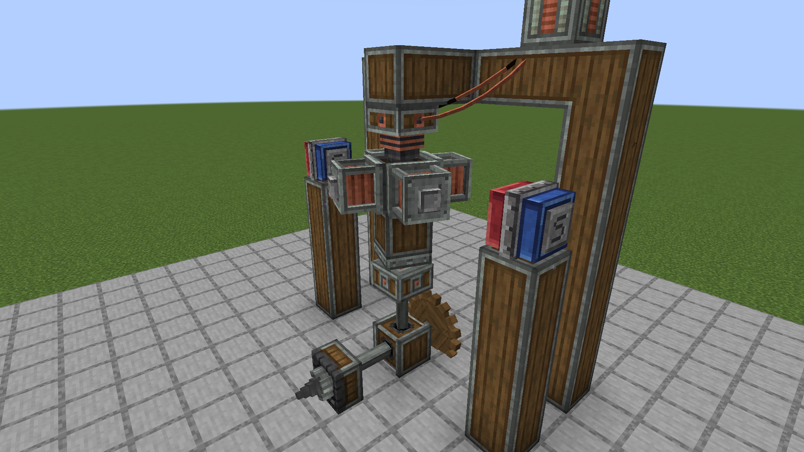
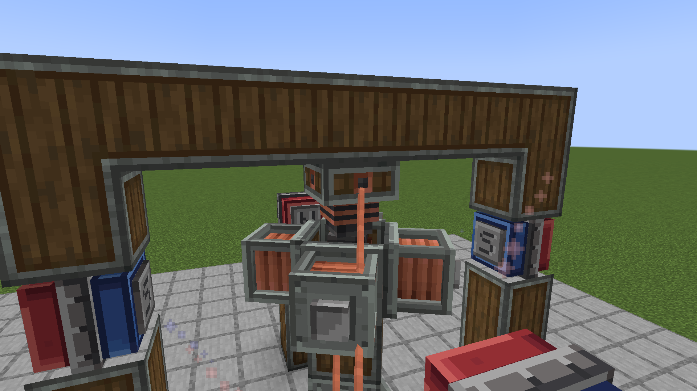

# Create: Induction

Build a real generator. Put magnets on a rotor, spin it with rotational force, and coils standing around it turn the passing magnets into electricity. Nothing is simulated behind a recipe or a multiblock check: the rotor is a [Sable](https://modrinth.com/mod/sable) physics structure, every magnet is a real magnet, and each coil measures the magnetic flux actually sweeping through it.

## How it scales

There is no bigger tier to craft. You get more power by engineering a better machine:

- **Faster** – voltage follows how quickly the flux changes, so power grows with the square of rotor speed.
- **Closer** – a magnet's field falls off steeply. One block of air gap is worth a lot.
- **More magnets, more coils** – every magnet that passes every coil adds to the output.
- **Smarter layout** – alternate poles, face magnets at the coils, mount coils above and below as well as around. Bad layouts cancel themselves out.

Electricity is never free. A coil that delivers power pushes back on the magnets (Lenz's law), the rotor slows, and the bearing has to work harder to keep it turning. The stress the bearing draws from your Create network is the mechanical power it really delivers, so an unloaded rotor is cheap to spin and a hard-working one is not.

## Start small

A generator does not need a creative motor. The bearing only takes the power its network can spare, so a few water wheels geared up turn a loaded rotor slowly instead of overstressing, and it speeds up as you add more.

## Off the grid

Coils and magnets do not have to sit on the block grid. Anything on its own physics structure counts, so with the Rivet from [Simulated Coasters](https://modrinth.com/mod/create-coasters-simulated) you can mount coils at any angle and fill the gaps a square layout leaves. Here four riveted coils between the four straight ones roughly double the output of the same rotor.

## Inside out

Real machines often spin the windings and keep the magnets still. That works here too: put the coils on the rotor, stand the magnets around it, and bring the electricity out through a pair of Slip Rings on the axis.

## Backwards: a motor

The same parts run the other way. Put the coils on the rotor around a Commutator, stand a north and a south pole either side, and feed a Slip Ring pressed against the Commutator. The Commutator reverses each coil as it turns past the magnets, the rotor spins, and the Dynamo Bearing under it, with nothing else turning its shaft, hands that rotation to your Create machines.

It behaves like a real DC motor. It starts by itself, runs faster with less load, slows as you hang more machines on the shaft and stalls if you ask too much. More coils, stronger fields and a tighter gap make it stronger.

## Blocks

**Dynamo Bearing** – Feed it rotation from behind, glue a structure to its face and click it with an empty hand. The structure becomes a physics rotor driven towards the shaft's speed. Its stress impact rises and falls with the load. Leave its shaft undriven and it works backwards: a rotor spun by coils turns the shaft.

**Permanent Magnet** – An always-on magnet. The red face is north. It attracts and repels the Redstone Magnets from Create Aeronautics exactly like they do each other.

**Induction Coil** – Generates from any magnet moving past its face: Permanent Magnets, Redstone Magnets, on a rotor, on an airship, on a pendulum. Works in the world or on a physics structure.
Give it a redstone signal and it runs the other way: it spends energy to become an electromagnet, with strength set by the signal. Pulse coils in time with a rotor and you have a motor.

**Slip Ring** – Carries electricity across a turning joint. Place two face to face, one on the moving structure and one beside it; while their faces touch they pass Forge Energy straight through, and with Power Grid they join their wire terminals like brushes on a ring. Useful on any rotating or swivelling build, not only generators.

**Commutator** – A Slip Ring cut into segments, for motors. It powers the coils attached to it, directly or through each other, and switches each one by its position. Scroll on it to set the number of magnet poles around the armature; a negative number reverses the motor. Feed it Forge Energy through its Slip Ring, or with Power Grid wire the Slip Ring's terminals to a supply.

Engineer's Goggles show voltage, current and power on coils, and rotor speed and delivered power on the bearing.

## Energy

- **Forge Energy** – coils hold a small buffer and push into any neighbouring block that accepts FE. A full buffer means no load, no current and no braking.
- **[Power Grid](https://modrinth.com/mod/power-grid)** (optional) – every coil gets a positive and a negative terminal on its back. Wire it up and it is a real voltage source in the circuit: the current your circuit draws is the current that brakes the rotor, and with a redstone signal, voltage applied from outside drives it as an electromagnet. A generating coil lets nothing flow back in, so it can charge a battery directly. A wired coil belongs to the circuit: it makes no Forge Energy while a wire is attached, and gives nothing until something on the circuit draws power. The goggles say so.

## Requirements

- [Create](https://modrinth.com/mod/create) 6.0.10+
- [Sable](https://modrinth.com/mod/sable) 2.0.6+
- [Create Aeronautics](https://modrinth.com/mod/create-aeronautics) (provides Simulated and its magnets)
- NeoForge, Minecraft 1.21.1. Needed on both client and server.

## Configuration

Everything that affects balance is in the server config `create_induction-server.toml`: magnet strength, coil gain and resistance, Forge Energy per watt, stress per watt and the bearing's torque and power limits.

## Notes

- Blocks on a rotor must be held together with Super Glue, as with any Create contraption.
- A rotor is a solid object. Leave room for it to turn; anything in its way stops it.
- Hanging wires to a Slip Ring on a rotor is done after assembling it.
- This is an early release. Balance values are a first pass and may change.
